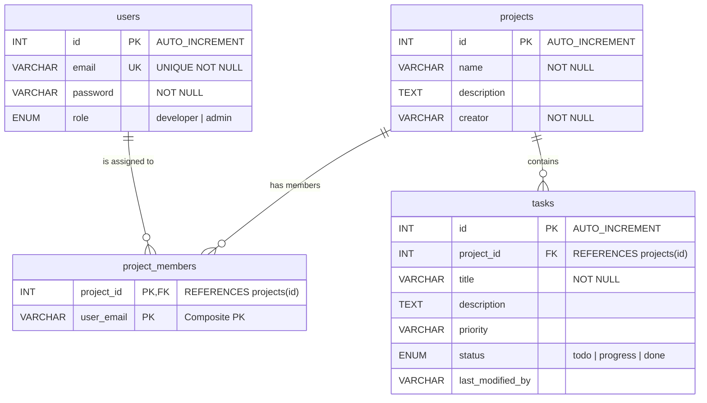
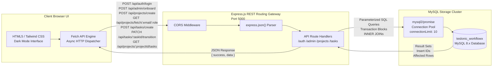
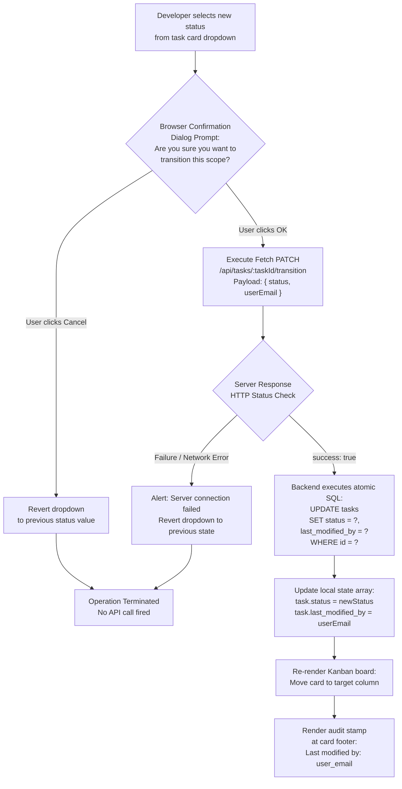

# WorkFlowX — Technical Report Diagrams

---

## Figure 1: Entity-Relationship (ER) Diagram

---

## Figure 2: Decoupled Client-Server Core System Architecture Model

---

## Figure 3: State Transition Audit Trail Workflow Logic

